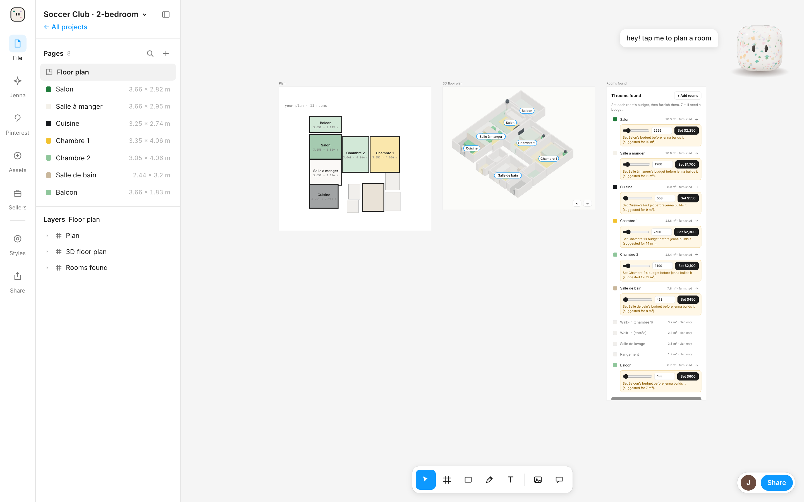
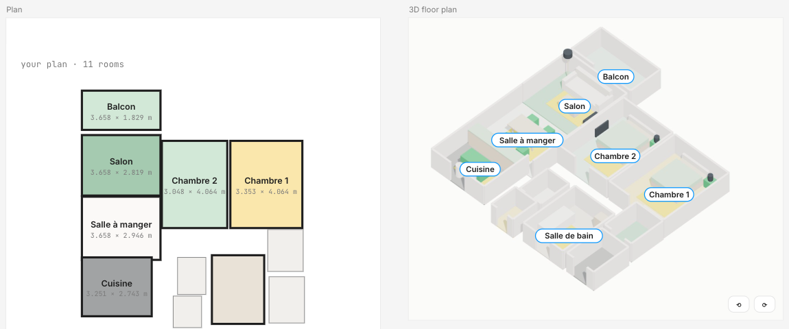
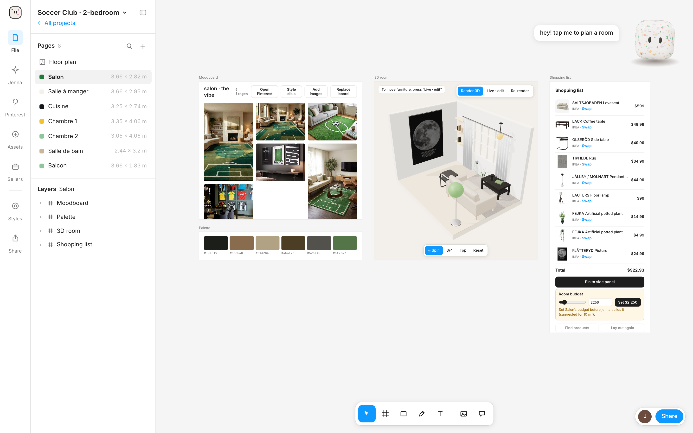
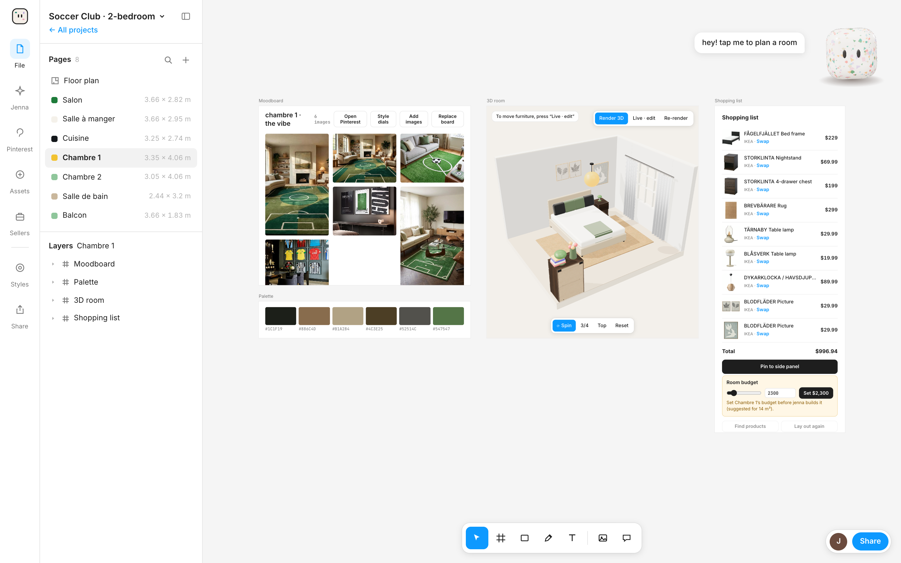
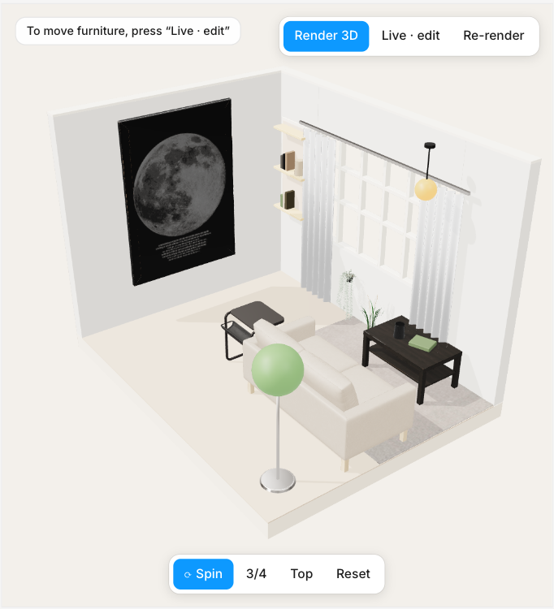
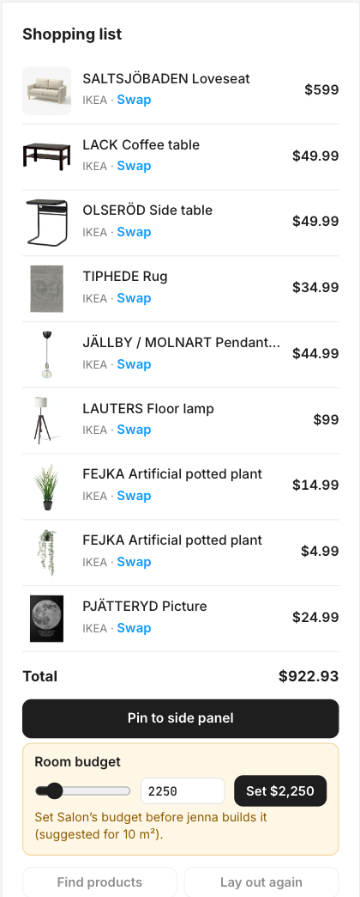

# hey jenna

Give it a **moodboard** and a **floor plan**. It finds **real furniture you can buy**
(IKEA, or any link you paste) in the same style and colours,
places it in your room with interior-design rules, and lets you move or swap pieces.

This repo holds the whole product: the **API** (`apps/api`), the **studio web app** (`apps/web`, React),
the Python **layout engine** and the Blender **render worker**.

- New here (person or agent)? Read [`docs/how-it-works.md`](docs/how-it-works.md), then [`docs/STATUS.md`](docs/STATUS.md): what's built, what's left, how we work.
- Setting up production? [`docs/production-setup.md`](docs/production-setup.md) lists every account and key.

## Screenshots

Taken from the *Soccer Club · 2-bedroom* demo project.

**Floor plan.** Every room is read from the drawing and shown in 2D and 3D, and each room gets its own budget before jenna furnishes it.





**A room.** Each room has its own page with the moodboard, the palette pulled from it, the furnished 3D room and the shopping list.





<table>
  <tr>
    <td width="60%"></td>
    <td width="40%"></td>
  </tr>
  <tr>
    <td><b>3D room.</b> Spin it, switch to live edit to drag or rotate pieces, or render it in Blender.</td>
    <td><b>Products.</b> Real IKEA pieces with prices, a swap for each one, the total and the room budget.</td>
  </tr>
</table>

## How it works

```
floor plan ──▶ rooms        (the room you drew: size, windows, doors)
moodboard  ──▶ style        (palette 60/30/10 + vibe + shop keywords; Claude vision or rules)
                 │
                 ▼
             sourcing       (shopping list from room + needs → search every source → size, colour, score)
                 │
                 ▼
             layout         (Python design engine places the products; repairs over-full rooms)
                 │
                 ▼
     move / turn / swap / remove pieces · shopping list with total price
                 │
                 ▼
             render         (job queue in Postgres → Blender worker → PNG + .glb 3D model)
```

## Stack

- **API:** NestJS (TypeScript), layered per feature: controller → DTO → service → repository → mapper
- **Database + auth + storage:** Supabase (Postgres via Prisma, Supabase Auth JWTs, Supabase Storage)
- **Layout engine:** Python (`engines/layout/design_logic.py`), standard library only, behind a `LayoutEngine` interface
- **Moodboard reading:** Claude (`claude-opus-5-5`) with schema-checked JSON; rule-based fallback without a key
- **Shared types:** `packages/contracts` (zod)

- **Web app:** Vite + React 18 + TypeScript, react-query, zustand, three.js (see `apps/web/README.md`)
- **Desktop app:** Electron shell for Mac: the studio with pinterest.com as a side panel tab, `npm run desktop` (see `apps/desktop/README.md`)

```
apps/web/src/    the studio: home carousel, editor (pages + frames), live 3D room, side panel (jenna chat, shopping list)
apps/api/src/
  common/        config · database · auth · storage · http (safe fetch) · validation
  modules/
    rooms/       hand-drawn floor plans
    projects/    a home or job that groups rooms
    style/       moodboard → palette + vibe
    sourcing/    shopping list · sources (IKEA, pasted link, mock) · sizes · scoring · picks
    layout/      engine adapter · spec builder · auto-repair · edits · shopping list
    render/      render jobs (Postgres queue, SKIP LOCKED) · worker endpoints · image / model files
engines/layout/  Python design engine
workers/render/  Blender render worker (Python, stdlib only) — see its README
packages/contracts/
```

## Run it locally

Needs Node 20+, Python 3, Docker.

```bash
npm install
npm run db:up                                  # local Postgres (stand-in for Supabase)
cp apps/api/.env.example apps/api/.env
npm run db:migrate
npm run dev                                    # API on http://localhost:3000
npm run web                                    # studio on http://localhost:5173 (proxies /api to the API)
npm run worker                                 # render worker (needs Blender 4.2+ and WORKER_TOKEN in apps/api/.env)
```

With the defaults (`AUTH_MODE=dev`) everything works with **no keys**: real IKEA products and their
3D models, rule-based moodboard reading and jenna chat, no login. Open http://localhost:5173, press +,
use "Draw rooms → Use sample plan", add moodboard images, then Find products → Lay out the room.
After pulling new code: `npm run build -w @hey-jenna/contracts`, `cd apps/api && npx prisma generate && npx prisma migrate deploy`.

| Turn on | Set in `apps/api/.env` |
|---|---|
| Real database | `DATABASE_URL` = your Supabase connection string |
| Real login | `AUTH_MODE=supabase`, `SUPABASE_URL` (+ `SUPABASE_JWT_SECRET` for older projects) |
| Supabase Storage | `STORAGE_DRIVER=supabase`, `SUPABASE_SERVICE_ROLE_KEY` |
| Claude reads moodboards | `ANTHROPIC_API_KEY` |
| IKEA (+ 3D models) | nothing: uses IKEA's own search and model files, on by default (`IKEA_LOCALE`, default `ca/en`) |
| A UI on another origin | `CORS_ORIGINS` (comma-separated; default `http://localhost:5173`) |
| Background jobs off in this instance | `JOBS_RUNNER=off` (jobs then wait for an instance with it on) |
| Renders (Blender worker) | `WORKER_TOKEN` (16+ chars, same value for the API and the worker; make one with `openssl rand -hex 32`) |

## Try the flow

```bash
B=http://localhost:3000

# 1. a room (metres; x = left→right wall, y = back→front wall)
curl -X POST $B/rooms -H 'content-type: application/json' -d '{
  "name": "Retro loft", "needs": ["has a cat", "works from home"],
  "floorPlan": { "width": 6, "depth": 4.8,
    "windows": [{ "id": "w1", "wall": "back", "position": 3, "width": 1.6 }],
    "doors":   [{ "id": "d1", "wall": "back", "position": 1.2, "width": 0.95 }] } }'

# 2. moodboard (files and/or https image links)
curl -X POST $B/rooms/$ROOM/moodboard -F images=@moodboard.jpg

# 3. find products
curl -X POST $B/rooms/$ROOM/listings/search -H 'content-type: application/json' -d '{"perType": 4}'
curl -X POST $B/rooms/$ROOM/listings/link   -H 'content-type: application/json' -d '{"url": "https://…"}'
curl -X PATCH $B/rooms/$ROOM/listings/$LISTING -H 'content-type: application/json' -d '{"picked": true}'

# 4. lay out the room, then play with it
curl -X POST  $B/rooms/$ROOM/layouts
curl -X PATCH $B/rooms/$ROOM/layouts/$LAYOUT/objects/desk_1 -H 'content-type: application/json' -d '{"x": 1.2, "rotationDeg": 90}'
curl -X PATCH $B/rooms/$ROOM/layouts/$LAYOUT/objects/sofa_1 -H 'content-type: application/json' -d '{"listingId": "…"}'
curl -X POST  $B/rooms/$ROOM/layouts/$LAYOUT/objects -H 'content-type: application/json' -d '{"listingId": "…"}'                  # a side table: lands beside a seat
curl -X POST  $B/rooms/$ROOM/layouts/$LAYOUT/objects -H 'content-type: application/json' -d '{"listingId": "…", "x": 5.6, "y": 4.4}'  # a plant, where you say
curl          $B/rooms/$ROOM/layouts/$LAYOUT/shopping-list

# 5. render it (the worker picks the job up)
curl -X POST $B/rooms/$ROOM/layouts/$LAYOUT/renders
curl $B/rooms/$ROOM/renders/$JOB                 # status → "done"
curl $B/rooms/$ROOM/renders/$JOB/image -o room.png
curl $B/rooms/$ROOM/renders/$JOB/model -o room.glb
```

## Endpoints

| Method | Path | What |
|---|---|---|
| GET | `/health` | health check (public) |
| POST / GET | `/rooms` | create / list rooms (optional `projectId` on create) |
| GET / PATCH / DELETE | `/rooms/:id` | one room. Rooms carry `planPosition` (`{x, y}` metres from the plan's top-left, or null); PATCH `{planPosition}` moves a room on the plan |
| POST / GET | `/projects` | create / list projects `{name, kind?, palette?}` |
| GET / PATCH / DELETE | `/projects/:id` | one project (delete keeps its rooms) |
| GET | `/projects/:id/rooms` | rooms in a project |
| POST | `/projects/:id/rooms/bulk` | create several rooms at once `{rooms: [{name, floorPlan, needs?}]}` (all or nothing) |
| POST | `/projects/:id/floor-plan` | one floor-plan photo → every room found and measured (multipart `image`, or `imageUrl`). Returns a preview `{rooms[{name, kind, confidence, position, floorPlan}], scaleSource, warnings[], imageKey}`; `?create=1` also creates the rooms (all or nothing, adds `created`). Needs `ANTHROPIC_API_KEY` (422 without) |
| POST | `/rooms/:roomId/moodboard` | upload moodboard (multipart `images`, optional `imageUrls` JSON); replaces the board, `?append=1` adds to it (max 8 images) |
| POST | `/rooms/:roomId/moodboard/pins` | add image links (e.g. pins dragged from Pinterest) to the moodboard `{pins: [{id, imageUrl (i.pinimg.com), link?}]}` (max 8 images in total); style and dials are re-derived |
| GET | `/rooms/:roomId/moodboard` | the stored moodboard images: `{images: [{id, url, source: 'upload' \| 'pin', link?}]}`. Pins keep their `i.pinimg.com` url and link; uploads point at the route below (a path on this API). `{images: []}` before any moodboard |
| GET | `/rooms/:roomId/moodboard/images/:imageId` | streams one stored image with its content type (`Cache-Control: private`); 404 for an unknown image. `` can't send headers, so this route also takes `?access_token=` (or `?dev_user=` in dev) |
| DELETE | `/rooms/:roomId/moodboard/images/:imageId` | removes one image, re-derives style and dials from the rest, returns `{images}` left. Removing the last one clears the style (`GET /style` is 404 again) |
| GET / PATCH | `/rooms/:roomId/style` | style profile / tweak it |
| POST | `/rooms/:roomId/listings/search` | search all sources. `?async=1` → `202 {jobId}` at once; progress + result over the events stream |
| POST | `/rooms/:roomId/listings/link` | add a pasted product link (auto-picked) |
| GET | `/rooms/:roomId/listings?type=sofa` | listings |
| PATCH | `/rooms/:roomId/listings/:listingId` | `{picked}` |
| GET | `/rooms/:roomId/listings/:listingId/model` | the product's 3D model (GLB), fetched once from IKEA and cached |
| POST / GET | `/rooms/:roomId/layouts` | generate / list layouts |
| GET | `/rooms/:roomId/layouts/:layoutId` | one layout (objects, checks, dropped, shopping list) |
| GET | `/rooms/:roomId/layouts/:layoutId/shopping-list` | items + total |
| PATCH | `/rooms/:roomId/layouts/:layoutId/objects/:objectId` | move/turn `{x, y, rotationDeg}`, swap `{listingId}`, or re-hang a wall piece `{wall, position, height}` |
| POST | `/rooms/:roomId/layouts/:layoutId/objects` | add one of the room's products. Wall piece (art, mirror, wall shelf): `{listingId, wall?, position?, height?}` (no spot → best free spot on a visible wall). Floor piece (armchair, side table, pouf, plant, floor lamp, shelf, sideboard, rug…): `{listingId, x?, y?, rotationDeg?}` (no spot → best free floor spot next to its partner: side table/lamp by a seat, plant in a corner, storage against a wall). Spots that stick out, block a door's 90 cm or put a tall piece in front of a window are refused with `problems`; overlaps come back as `warnings` |
| DELETE | `/rooms/:roomId/layouts/:layoutId/objects/:objectId` | remove a piece (wall pieces too) |
| POST | `/rooms/:roomId/layouts/:layoutId/renders` | queue a render |
| GET | `/rooms/:roomId/renders` · `/rooms/:roomId/renders/:jobId` | render status |
| GET | `/rooms/:roomId/renders/:jobId/image` · `/model` | the PNG / .glb |
| GET | `/rooms/:roomId/events` | live updates (server-sent events): `data: {type, roomId, at, data}` for `listings.search.*`, `layout.generated`, `layout.object.added/moved/removed`, `render.queued/running/done/failed`, `job.queued/running/done/failed`; `: ping` every 20 s. EventSource can't send headers, so this route also takes `?access_token=` (or `?dev_user=` in dev) |
| GET | `/rooms/:roomId/jobs/:jobId` | a background job's status / result (polling fallback) |
| GET | `/models?url=<https://web-api.ikea.com/…glb>` | any allowed 3D model (`MODEL_HOSTS`; https, ≤ 40 MB, must be glTF), cached in storage; `model/gltf-binary`, long cache headers, `x-cache: hit/miss` |
| POST | `/rooms/:roomId/chat` | chat with Jenna: `{message, history?}` → `{reply, actions[]}`. With `ANTHROPIC_API_KEY` Claude uses tools (read style, tweak dials, search listings, lay out, shopping list); without it, rules (palette / fit check / shopping list / find similar). History is not stored: send it back each time |
| POST | `/internal/render-jobs/claim` · `/:jobId/complete` · `/:jobId/fail` | render workers only (`x-worker-token`) |

## Tests

```bash
npm test        # unit tests, including real runs of the Python engine
```

## Known limits

- Rooms are rectangles (4 walls). L-shaped rooms need polygon support in the engine.
- A layout takes ~4 s; over-full rooms that need auto-repair can take ~20–25 s.
- Some rooms keep one failed check (e.g. tight seat access with large real products); it is reported in `checks`.
- Renders colour pieces from the moodboard palette, not from each product's own colour yet.
- The renderer cuts windows and doors in the back wall only.
- A full-quality render takes ~45 s on an M1 Pro.
- Live updates are in memory: with several API instances, each only sees its own events (needs Postgres LISTEN/NOTIFY or Redis).
